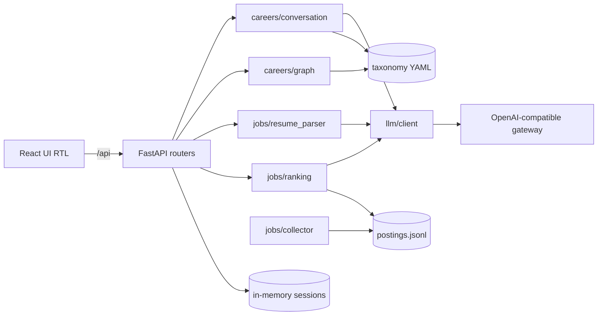

# Architecture



## Contracts (`backend/app/schemas.py` ↔ `frontend/src/types.ts`)

| Contract | Fields |
|---|---|
| `Level` | junior \| mid \| senior |
| `CareerProfile` | target_role, target_level, current_level, known_concepts, heard_of_only |
| `ChatRequest` / `ChatResponse` | session_id, message / reply, profile?, done, questions_asked |
| `Roadmap` | role, level, nodes[`RoadmapNode`], edges[`RoadmapEdge`], order, summary_fa |
| `RoadmapNode` | id, label_fa, label_en, layer, status (todo\|known), resources[`Resource`] |
| `Resource` | title, url, lang, type, verified |
| `CorrectionRequest` | session_id, message |
| `ResumeProfile` | skills, skill_ids, years_experience, education, previous_roles, location, level_guess |
| `JobPosting` | id, source, title, company, location, remote, seniority, requirements, skill_ids, published_at, url |
| `JobMatch` | posting, score, matched_skills, missing_skills, explanation_fa |
| `MatchRequest` | session_id, filters{location?, seniority?, remote?}, method (baseline\|hybrid) |
| `UsageReport` | session_id, prompt_tokens, completion_tokens, est_cost_usd, calls |

## Data flow

**Module A:** chat (≤6 questions) → `chat_json` → `CareerProfile` → ids validated against taxonomy (unknown discarded) → `compute_roadmap` (targets + transitive prerequisites − known, topological order, layers) → resources attached → graph. A correction message → LLM updates the profile → roadmap recomputed.

**Module B:** upload → text extraction (PyMuPDF/python-docx) → `chat_json` → `ResumeProfile` → `map_skills` to concept ids → filter postings → rank → top 10 `JobMatch` with matched/missing skills. Collector (offline, `make collect`): polite fetch → parse → normalise → dedup → `postings.jsonl`.

## Taxonomy YAML (`backend/data/taxonomy/`)

```yaml
# concepts.yaml
- {id: pandas, label_fa: پانداس, label_en: Pandas, prerequisites: [python_basics], aliases: [pandas]}
# roles.yaml  (levels are cumulative)
- {id: data_analyst, label_fa: تحلیلگر داده, label_en: Data Analyst, domain: data,
   levels: {junior: [excel, sql_basics, pandas], mid: [], senior: []}}
# resources.yaml
- {concept: sql_basics, title: SQLBolt, url: "https://sqlbolt.com/", lang: en, type: course, verified: true}
```

## Ranking design

- **Baseline:** BM25 (`rank_bm25`) — query = resume skills + roles, docs = posting title + requirements.
- **Hybrid:** `score = (w_skill · skill_score + w_embed · cosine(embed(resume), embed(posting)) + w_seniority · seniority_fit) / Σw`. Weights live in `config.py` (`w_skill_overlap`, `w_embedding`, `w_seniority`). Embedding failure → the embedding term is dropped. The LLM re-rank (`llm_rerank`, `llm_rerank_top_k`, `RERANK_SYSTEM`) is config only and **not implemented**.
- Matched/missing = posting `skill_ids` ∩ / − resume `skill_ids` (deterministic).

## Evaluation protocol

3 synthetic resumes × ≥20 postings each, labelled relevant/not in `data/eval/labels.csv`. Run `make eval`: Precision@5 and nDCG@10 (binary gains) per resume, averaged, for baseline vs hybrid. Paste the table into `docs/REPORT.md`.

## P2 implementation and integration

P2 uses the existing synchronous `chat`, `chat_json`, `embed`, and `LLMResult` interfaces.
The first JSON attempt includes the Pydantic schema; there is at most one repair,
with an 8-second shared budget and SDK retries disabled. HTTP timeouts are applied
using the remaining budget; this is not proof of a hard wall-clock latency bound.
JSON object mode and optional temperature are configuration switches, without per-request
capability probes or automatic provider fallback. Blank gateway URL, key, or requested
model returns a configuration error. No live gateway requests have been made.

An in-memory typed observation draft retains explicit known/heard/unknown evidence.
Python selects one Persian question per turn, capped at six, and validates IDs against
the complete loaded taxonomy. P1's role matcher and ancestor helper are merged integration
dependencies: P2 refuses to publish a profile if ancestor validation is unavailable.
Only the relevant role's concepts/prerequisites enter the compact model context.
A conflict between known prerequisite closure and explicit negative evidence blocks
publication and prompts clarification within the remaining budget. Negative corrections
with conflicting dependents return a safe conflict outcome; unrelated knowledge stays.
Repeated accepted positive/heard/negative corrections are idempotent. Corrections return
a candidate and commit profile/evidence only after real graph success;
P1's Persian summary is passed through unchanged. Older P1 stub fallback restores the
previous profile first and is only a development placeholder.

Sessions have separate state and usage locks; independent sessions do not share drafts.
Failure does not add chat history. Resume extraction and model calls run in a threadpool,
with a per-session lock and commit only on success. Upload reads stop at limit + 1 bytes
and close reliably. Framework `UploadFile` may spool multipart data before the endpoint;
P2 does not guarantee raw-upload memory-only processing. Extracted text/profiles are never
written to disk. DOCX paragraphs/tables retain document order; PDF pages remain separated.
Empty/scanned/encrypted/corrupt files have controlled outcomes; OCR is not installed by P2.

Usage counts attempted calls, including upstream failures and JSON repair, regardless of
usage metadata. Received usage is accumulated without per-call cost rounding. `PRICE_TABLE`
contains operator estimates for exact model IDs in USD per million input/output tokens;
there is no fallback price. Internal `usage_complete` and `cost_complete` flag missing
metadata/prices; the frozen `UsageReport` cannot expose these flags. Zero/partial totals
are therefore not verified free calls or complete invoices. `PRICE_BASIS` records the
operator's estimate basis. Logs do not include content or provider exception strings.

Frozen-contract limitations: `junior` is the lowest planning band for beginners, not proof
of employment. Target seniority must be supplied. Missing resume experience remains null
in the private extraction model; because public `years_experience` cannot be null, the
endpoint returns an incomplete-extraction error instead of inventing zero. Changing that
public field or exposing accounting completeness requires a separate team agreement.
